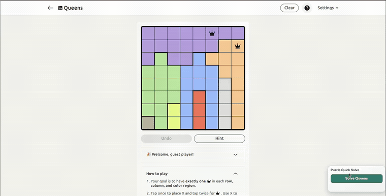
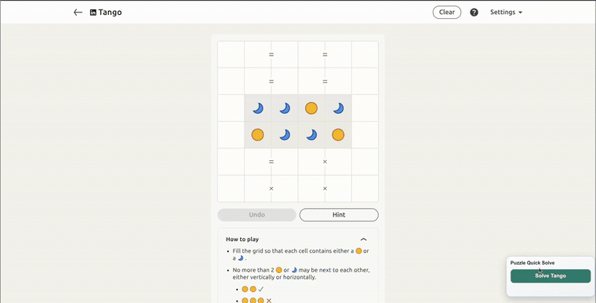
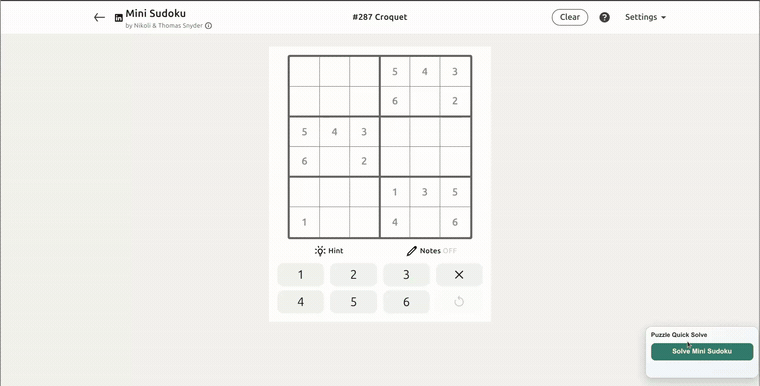
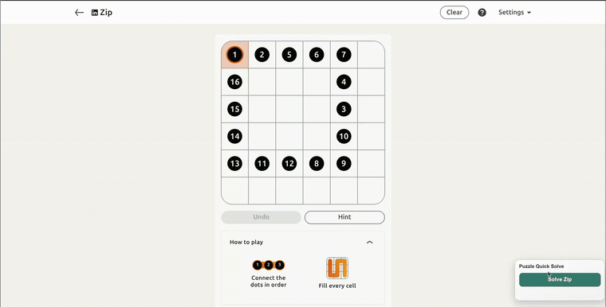
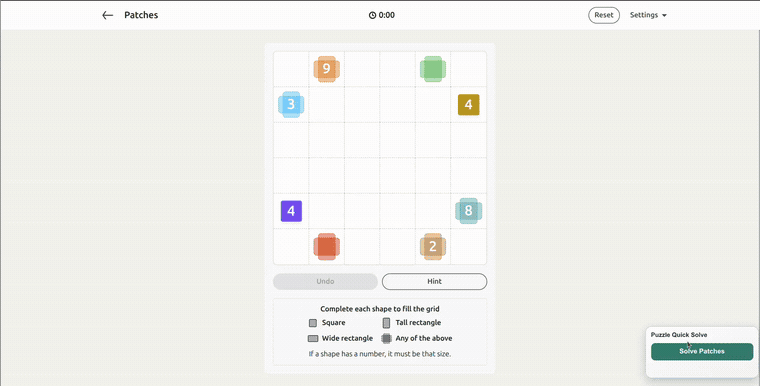
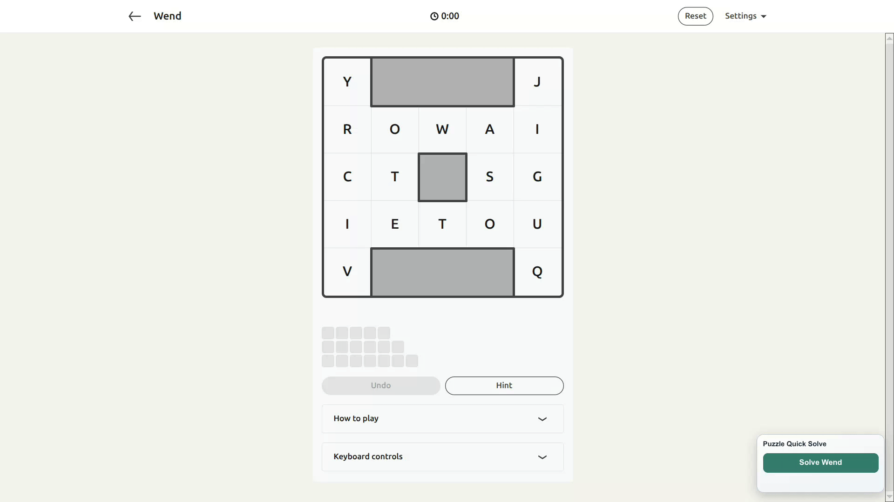

<p align="center">
  
</p>

<h1 align="center">LinkedIn Puzzle Solvers</h1>

<p align="center">
  <strong>Daily LinkedIn puzzles, solved locally.</strong>
  <br>
  Browser extension + FastAPI solver service powered by computer vision and puzzle-specific automation.
</p>

<p align="center">
  <a href="https://github.com/santipvz/linkedin-puzzle-solvers/actions/workflows/ci.yml"></a>
  
  
  
  
</p>

<p align="center">
  <a href="https://github.com/santipvz/linkedin-puzzle-solvers/stargazers"></a>
  <a href="https://github.com/santipvz/linkedin-puzzle-solvers/fork"></a>
  <a href="https://github.com/santipvz/linkedin-puzzle-solvers/issues"></a>
  <a href="https://github.com/santipvz/linkedin-puzzle-solvers/pulls"></a>
</p>

<p align="center">
  
  
  
  
  
  
</p>

<p align="center">
  
</p>

## Demo Gallery

<table border="0" cellspacing="0" cellpadding="0">
  <tr>
    <td width="50%">
      <h3 align="center">Queens</h3>
      
    </td>
    <td width="50%">
      <h3 align="center">Tango</h3>
      
    </td>
  </tr>
  <tr>
    <td width="50%">
      <h3 align="center">Mini Sudoku</h3>
      
    </td>
    <td width="50%">
      <h3 align="center">Zip</h3>
      
    </td>
  </tr>
  <tr>
    <td width="50%">
      <h3 align="center">Patches</h3>
      
    </td>
    <td width="50%">
      <h3 align="center">Wend</h3>
      
    </td>
  </tr>
</table>

<p align="center">
  
</p>


## Get started

Use the stable `main` branch or a release tag. `develop` contains work for the next release.

For online solving, load the extension as in step 2 and select **Online** in its popup. No local API is needed; the board image is sent to our hosted service. For local processing, follow all three steps below.

1. Start the API from the repository root:

   ```bash
   mkdir -p datasets
   docker compose -f deploy/local/docker-compose.yml up -d --build
   ```

2. Load the extension:
   - **Chrome/Chromium:** open `chrome://extensions`, enable Developer mode, and load `extension/` unpacked.
   - **Firefox:** open `about:debugging#/runtime/this-firefox` and load `extension/manifest.json` as a temporary add-on.

3. Open a supported [LinkedIn game](https://www.linkedin.com/games/), choose **Local / custom**, set **Preferences → Service address** to **`http://127.0.0.1:18000`**, and click **Solve & apply**.

The API health check is [localhost:18000/health](http://127.0.0.1:18000/health).

## Documentation

- [Extension usage and troubleshooting](extension/README.md)
- [Docker configuration](deploy/local/README.md) · [Vercel deployment](docs/vercel.md) · [API endpoints and settings](services/solver_api/README.md)
- [Contributing and Gitflow](CONTRIBUTING.md) · [Architecture](docs/architecture.md) · [Releases](docs/release.md)

MIT license. See [LICENSE](LICENSE).
