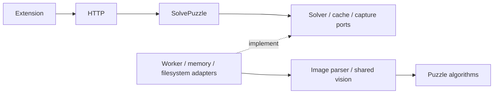

# Architecture

The backend follows [hexagonal architecture](https://alistair.cockburn.us/hexagonal-architecture): application code defines ports; infrastructure implements them. HTTP, files, process execution, and computer vision stay outside the solving rules.

## Boundaries

| Layer | Location | Responsibility |
| --- | --- | --- |
| Domain | `app/domain/`; puzzle algorithms under `games/*_solver/src/` | Requests, errors, puzzle rules and search |
| Application | `services/solver_api/app/application/` | `SolvePuzzle`, validation, cache policy, solver/cache/capture ports |
| Inbound adapters | `extension/`, `app/adapters/http.py`, game CLIs | Browser interaction and HTTP/CLI input |
| Outbound adapters | `app/adapters/`, `app/workers/`, image parsers, `core/vision/`, `core/commons/` | Worker execution, storage, cache, OCR and board detection |
| Composition | `app/bootstrap.py`, `app/settings.py`, `app/main.py` | Construct adapters and inject them into the application |

`app/` above is `services/solver_api/app/`. Existing game paths remain stable: Queens' image orchestrator is an adapter; its `src/core/` models and `src/solver/` algorithms are domain code. Tango receives a frame-recorder port for optional GIF output.

## Request flow

`SolvePuzzle.execute(SolveRequest(...))` can run with fake ports, without FastAPI, files, OCR, or subprocesses. The HTTP adapter translates application errors into HTTP statuses. Storage failures remain optional; worker exceptions do not enter the cache. Worker adapters own temporary images, cleanup, process timeouts, and legacy game import isolation.

## Dependency rules

- Domain imports no application, transport, vision, or storage adapters. NumPy is allowed for numerical puzzle algorithms.
- Application imports domain and its own ports, never concrete adapters or frameworks.
- Adapters depend inward; only the composition root chooses implementations.
- Puzzle-specific parsing stays in each game; generic vision mechanics stay in `core/`.

`python3 scripts/check_architecture.py` enforces these import boundaries in CI. Application tests inject fake ports; integration fixtures verify all six game pipelines and the existing HTTP contracts.
